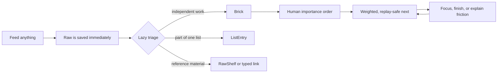
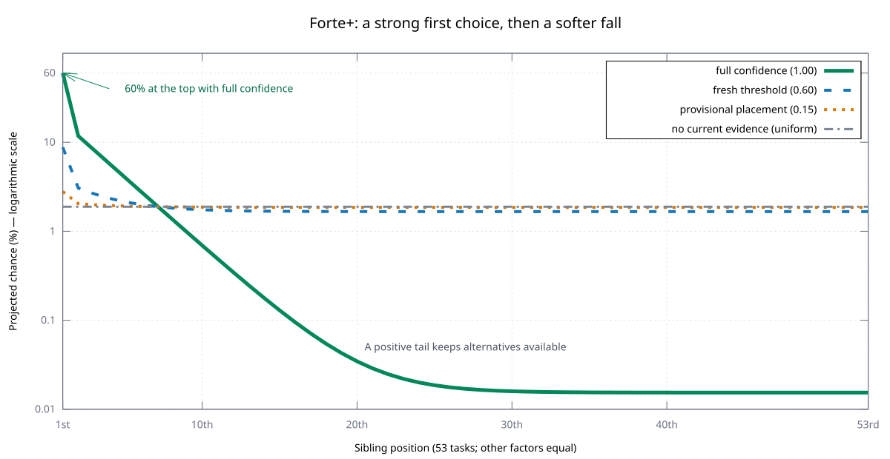
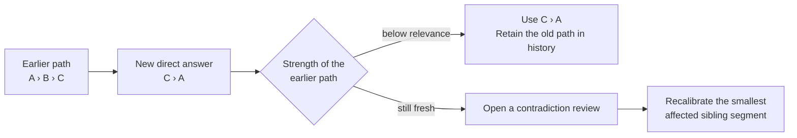
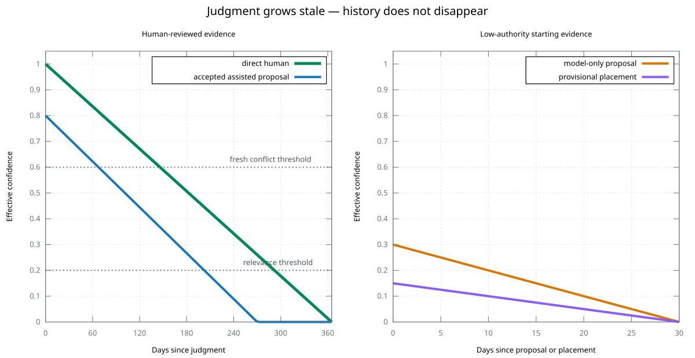
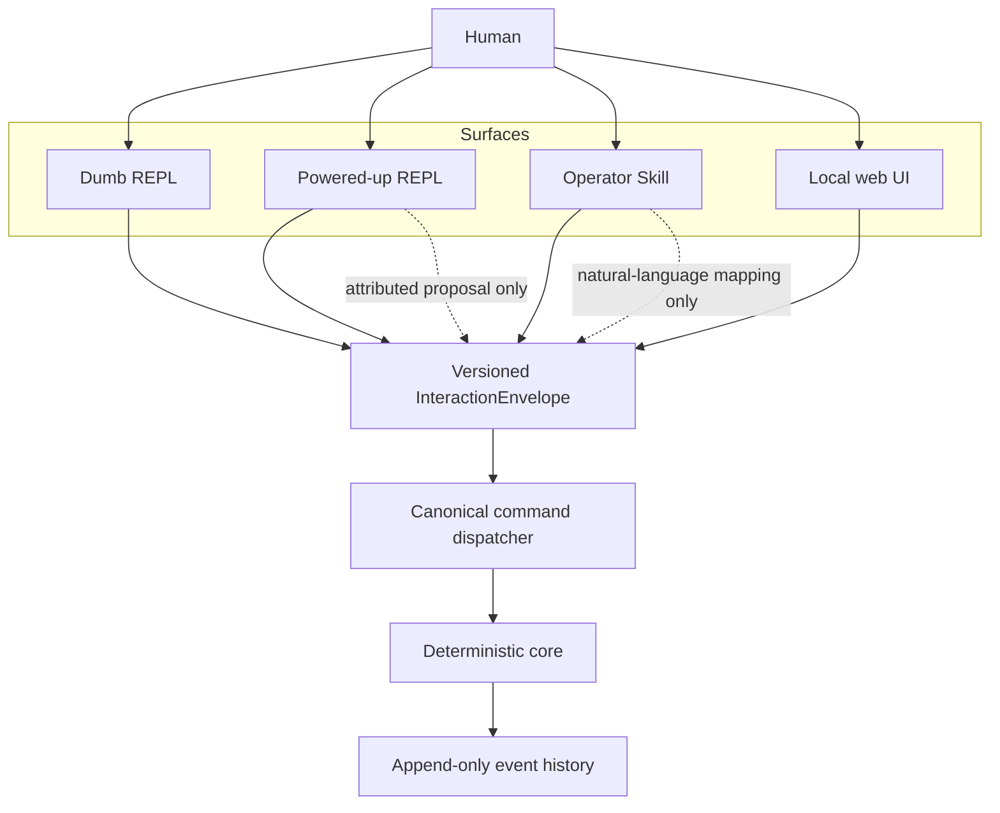

# Little Ant 🐜🧱

<p align="center">
  
</p>

> *One brick at a time. Inch by inch, anything's a cinch.*

> [!IMPORTANT]
> Little Ant 1.0 is being delivered incrementally. The local `1.0.0-alpha.2`
> supports the dumb daily loop and safe migration from the author's real v0
> dataset; integrations and assisted surfaces remain experimental. See the
> [alpha contract](implementation/releases/v1-alpha.md),
> [alpha.2 release notes](implementation/releases/v1-alpha.2.md), and
> [beta backlog](implementation/releases/v1-beta.md).

## TL;DR

Little Ant is a personal focus engine for people who have more intentions than
attention.

- **Feed first, organize later.** Any text, URL, note, or imported item is saved
  immediately as Raw material. Classification is lazy.
- **Importance is human; focus is dynamic.** You maintain a strict importance
  order. Little Ant separately calculates what is useful and eligible now.
- **Next is a deterministic weighted draw.** Important work is much more likely,
  but the long tail never disappears.
- **One work abstraction.** A Brick can stay small, become a project, own a
  checklist, repeat, recur, form a habit, or represent an exact commitment.
- **Dumb mode is complete.** AI may suggest, translate, or prefill, but it never
  supplies a missing workflow or mutates the core directly.

Most tools solve only one part of this problem: storing tasks, scheduling fixed
events, planning projects, tracking habits, or chatting with an AI. Little Ant
connects those parts without hiding judgment inside an opaque score. See
[Alternatives](#alternatives) for the trade-offs.

## Install the local alpha

[Nix](https://nixos.org/download/) builds the release and keeps its runtime
dependencies isolated:

```sh
git clone https://github.com/felipelalli/little-ant.git
cd little-ant
git switch main
nix profile install --profile ~/.nix-profile path:.#little-ant
~/.nix-profile/bin/lant --version
```

The last command prints `lant 1.0.0-alpha.2`. Run `lant` for the one-key dumb
REPL or use the same engine directly, for example:

```sh
lant feed "buy milk"
lant next
lant search milk
lant order
```

If an older `lant` appears earlier in `PATH`, invoke
`~/.nix-profile/bin/lant` explicitly or adjust `PATH` before migrating. The
[alpha contract](implementation/releases/v1-alpha.md) lists the supported
surface and the deliberately deferred beta work.

For an existing installation from this checkout, update the same Nix profile:

```sh
nix profile upgrade --profile ~/.nix-profile little-ant
~/.nix-profile/bin/lant --version
```

Use the same explicit `--profile` location for installation and upgrades. A
different default Nix profile can otherwise update successfully while the
executable on `PATH` remains old. This Nix profile is separate from LANT's
`--profile NAME`, which chooses a dataset.

### Use Little Ant from Codex

The package includes a compact [alpha operator skill](skills/little-ant/SKILL.md)
alongside the CLI. Install one discovery link:

```sh
mkdir -p ~/.agents/skills
ln -s ~/.nix-profile/share/little-ant/skills/little-ant ~/.agents/skills/little-ant
```

The link follows future Nix profile upgrades, so the skill and executable come
from the same package. If a skill already exists at that location, inspect it
before replacing it. Invoke `$little-ant`, or ask Codex to operate your LANT
tasks. If it does not appear in the skill selector, restart Codex.

This operator uses the installed CLI and its headless interaction transport for
guided decisions. It supports the current alpha; it does not claim the complete v1
Skill mirror, powered-up mode, or the beta's full paired-replay coverage.

### Use the CLI without the REPL

Use `--non-interactive --json` for scripts and skills. The CLI never opens the
REPL or prompts on the terminal in that mode. It returns `status: completed`,
`awaiting_input`, or `simulated`; exit codes are 0 for success, 2 when a command
needs an answer, and 1 for errors. A successful `interaction show` inspection
exits 0 even if the inspected question still needs an answer.

```sh
lant --non-interactive --json archive '#handle' --yes
lant --non-interactive --json restore '#handle' --yes
lant --non-interactive --json update '#handle' description --text-file description.md --yes
```

Without `--yes`, lifecycle commands return the ordinary preview. To continue
any guided flow, save its JSON result and respond to an actual action ID:

```sh
lant --non-interactive --json interaction show > question.json
lant --non-interactive --json interaction respond --from question.json --action archive.accept
```

Input actions also accept `--text TEXT` or `--text-file FILE` (`-` for stdin).
An old or modified question fails validation; an answer never carries to its
replacement. `--dry-run` simulates even the direct confirmed forms. Vault and
static-provider secrets can use explicit `--secret-stdin`, one line per secret,
without secret-bearing arguments. See the [transport contract](spec/little-ant-1.0/command-catalog.md#headless-interaction-transport)
and [complete CLI audit](implementation/reviews/2026-10-15-headless-cli.md)
for all command families, secret input, and remaining experimental boundaries.

### Use the skill and REPL in separate tabs

Clients using the same LANT profile and dataset share their task data **and one
pending question with its navigation history**. Each tab does not get an
independent guided session; dumb mode does not provide session isolation.

For now, let one client conduct guided decisions and changes at a time. A
second tab can use `list importance`, `list forecast`, or `why`; these queries
preserve the pending question. `next` can record a selection, while `focus`,
`order`, `effort`, and other guided routes can replace the shared question.

The REPL does not automatically refresh after another client changes the
dataset. Its next engine operation revalidates the action and may return a
replacement question or an error. Read that result before answering again;
an old keypress is not consent to a replacement question.

**Known alpha limitation:** canonical event writes use a writer lock, but
concurrent saves of the shared presentation checkpoint remain unprotected.
Two active flows can overwrite each other's pending navigation or encounter a
checkpoint write/read error. Simultaneous guided editing is therefore not yet
fully supported. See the [technical limitation and remaining work](implementation/adr/0003-persisted-guided-checkpoints.md#current-alpha-concurrency-limitation).

## Why Little Ant?

A normal task list slowly becomes a museum of good intentions:

1. new material arrives faster than it can be classified;
2. a single “priority” field mixes importance, urgency, readiness, and mood;
3. the top item becomes repetitive, so the list is ignored;
4. old judgments silently become stale;
5. every new tool introduces another inbox.

Little Ant replaces that cycle with one small loop:



The happy path stays short. Structure appears only when real use reveals that
it is needed.

## The model

### Raw: preserve before interpreting

Every accepted `feed` creates one durable Raw in the Inbox. A Raw can contain
text, a URI, structured data, or a blob. It can later become:

- a Brick description;
- evidence or an attachment;
- the source of a Brick or ListEntry;
- material on one or more flat RawShelves;
- a source-backed snapshot that can be reconciled later.

Routing never consumes the Raw. Original content, revisions, provenance, and an
optional attributed English normalization remain distinguishable.

```text
Feed Little Ant

Tip: prefer English for consistent titles and search.

› milk
```

Pressing Enter creates `+milk "milk"` and returns to the ordinary useful
envelope without a receipt screen. No Nature, Domain, date, importance, or
destination is required at entry time.

### Brick: one intention, as much structure as needed

A Brick is the universal unit of work. It starts active and has one position
among its siblings. It may later become done, archived, superseded, or merged.
Scheduled commitments additionally record missed or cancelled outcomes.

`seed`, `committed`, and `ready` do not exist. Higher placement in the
importance tree already expresses stronger commitment.

Optional phase is independent:

```text
💡 idea  →  📐 spec  →  🔨 execution  →  🧪 validation
```

If “carry this enormous rock” proves too large, skip diagnosis can propose
breaking it into parts. The same Brick keeps its identity and becomes a
project; its children then carry execution. The interface does not begin with a
project-management form.

### ListEntry, Nature, Template, and Domain

| Concept | Plain meaning |
|---|---|
| **ListEntry** | A lightweight item shown with its owning checklist, such as Milk under Buy groceries |
| **Nature** | A small core behavior profile: task, project, collection, checklist, repeatable, obligation, habit, or scheduled commitment |
| **Template** | An inspectable creation recipe such as `grocery_list`, `flight`, `bug_fix`, or `physical_activity` |
| **Domain** | A non-exclusive hierarchical subject such as `Orbit › R&D › Rock Splitter` |

Composition and Domain are independent. One Brick may belong to several
Domains without being copied.

## Importance is not next

Little Ant exposes two views because they answer different questions:

| View | Question | What changes it? |
|---|---|---|
| **Importance order** | “What matters more?” | Human comparisons between siblings |
| **Focus forecast** | “Where might attention be useful now?” | Eligibility, importance, dates, context, pressure, reviews, and replay-safe chance |

Binary insertion asks one concrete question:

```text
Is

#rlp "Release the payment service"

    more important than

#icr "Investigate customer reports"
?

[m]ore important   [l]ess important   [s]kip   I don't [k]now
```

Skip is not equality. Little Ant tries a nearby comparison and may eventually
keep a provisional strict position that will return for validation.

<p align="center">
  
</p>

The factory **Forte+** curve gives the first sibling approximately 60% of its
local draw at full confidence with otherwise equal, admitted siblings. The
remaining 40% follows a softer decline: 98% uses a geometric ratio of 0.70,
and 2% is shared uniformly. Low confidence still blends toward neutral;
context, pressure, gates, and hierarchy can change the final forecast.
Every eligible candidate retains positive probability. New draws identify the
revised profile; historical selections keep their original evidence.
The exact fixed-point formula and reference vectors are
[normative and inspectable](spec/little-ant-1.0/deterministic-calculation-profile.md).

### Judgment can become stale

Little Ant evaluates a contrary answer against the surviving authority of the
path it challenges:



The factory profile turns provenance and age into four public labels:

<p align="center">
  
</p>

Direct human answers start stronger and age more slowly. Assisted proposals
and provisional placements retain their provenance. A conflict among fresh
judgments opens recalibration; an old weak path moves into history. Exact
values and reference vectors remain
[normative and inspectable](spec/little-ant-1.0/deterministic-calculation-profile.md).

## The daily experience

The REPL begins with one useful proposal:

```text
Work:

#rrsr "Review Rock Splitter rules"

Focus?

[y]es    [s]kip    I don't [k]now
[/] more...
```

Accepting it produces a quieter resting screen:

```text
Current focus:

#rrsr "Review Rock Splitter rules"

[d]one    [s]kip    [/] more...
```

To browse your work, type `/list` to open importance order directly. Press `v`
for forecast chances, `t` for categories with projects and subtasks, and Ctrl+F
to search the current list. While searching, letters are ordinary text; Escape
clears search before leaving the list. Ctrl+F again keeps the query and resumes
view shortcuts. Use arrows to select and Enter to inspect
a Brick; Escape restores the same list. Its detail view includes status, Nature,
Domains, children, blockers, checklist items, and attached material. From a
Brick detail, `f` proposes focus and `u` opens its guided update.

Read-only documents render Markdown headings, emphasis, code, and visible link
destinations. Ordinary paragraphs reflow and justify inside a reading width of
up to 96 terminal cells; lists, metadata, and code remain left aligned. The
stored material and CLI/JSON projections retain their original text.

The uncertainty shortcut on a Focus proposal opens that Brick's complete existing context
directly, with its title shown once. Use `[d]ecide about focus` to review
clarity and consent, `[b]ack to suggestion` to return to the proposal, or
`[w]hy this appeared` to inspect the draw; that explanation offers
`[t]ask context` to return. After reading, it asks whether the task and starting point are clear;
`yes` reaches a separate Focus confirmation. `why this appeared` optionally
shows the recorded draw. These views preserve the draw and any current focus;
only the final explicit confirmation starts Focus. Powered-up mode remains beta work.

In the REPL, `done` and `/done` advance to the next opportunity with a
`✓ Completed: #brick "Title"` confirmation above it. The confirmation stays
until your next interaction and survives terminal resizing. A new Work still
asks for Focus consent; an empty forecast shows the safe-empty screen.
Noninteractive `done` returns its completion result without another draw.
Repeatable Work retains its return-policy questions.

Archiving previews the prerequisites and dependents whose relationships will
be removed. Historical edges remain inspectable and do not reactivate when
Work is restored. Archived or superseded prerequisites cannot keep active
Work blocked. Older snapshots rebuild from the original events automatically.

`Ctrl-F` opens global search, including completed and archived work. Escape
returns through the results to the exact screen or unfinished draft you left.
Use the mouse wheel, Page Up/Page Down, Home/End, or the arrow keys to scroll
paginated detail, help, and task-context views. The wheel also moves through
paginated selectors without activating an item. The footer stays visible on smaller terminals. On the main screen,
Escape returns through pending navigation and then exits. Outside text input
and filtering selectors, `q` exits without adding a main-screen action.
`/exit`, its exact `/quit` spelling, and Ctrl-C also exit. The pending question
and current focus are retained.

The Store creates a disposable fold snapshot and rotates covered command
segments into `archive/YYYY-QN/` after 128 accepted command groups. Startup
then reads the snapshot and hot suffix. The canonical event bytes stay intact;
`doctor`, repair, and history inspect both hot and cold segments. A missing or
corrupt `projections/fold-snapshot.json` falls back to full replay. Physical
rotation preserves current focus, handles, closed cycles, and later restores.

Use `/why` to explain the selection currently on screen. It shows the recorded
chance, order confidence, and relevant pressure; `d` toggles calculation details
and `b` or Escape returns. The CLI equivalents are `lant why`,
`lant --view complete why`, and `lant --json why`. Inspection never redraws.
Older records report which historical details are unavailable.

Forecast percentages describe the chance of reaching an item in a new flexible
`next` draw. Many eligible items naturally have small absolute percentages;
an imported provisional order has less influence until human comparisons
provide evidence. Brick rows show their importance position, parent, and
importance confidence separately from this chance. Positions are sibling-local
and use the same zero-based order keys as the importance view, including any
gaps preserved by migration. Forecast rows also separate Work and ordering-review
chances below the subject total. Unresolved sibling order contributes one
maintenance opportunity, with pressure from low confidence and age. A lottery
comparison asks one pair; `lant order` keeps the continuous ordering workflow.
Two skips preserve uncertainty and defer that review for 24 hours.

The offline HTML exporter uses the same category/part organization, with native
collapsible branches and separate composition and dependency sections.

Exiting and reopening resumes the same pending question or Focus proposal
while its dataset state remains current. It does not record a skip or draw
again. The dataset keeps one random seed and advances persistent counters for
new draws, making the sequence reproducible from the same seed, counters, and
state. Reopening a retained proposal does not advance those counters.

The CLI exposes the same read-only views:

```sh
lant list importance
lant list forecast
lant list importance '#parent'
lant search '#brick'
lant show '#brick' --view complete
lant export tree
lant export html --output little-ant.html
```

The text tree shows composition (parents and children) in importance order.
The self-contained HTML explorer opens with the actual Domain hierarchy,
collapsible category branches, and clickable Brick references. It also shows
composition and unresolved prerequisites, including scope boundaries and
shared blockers. All views work offline with native HTML controls.
Export accepts a new output path and does not
overwrite an existing file. Domain scope is available with `--scope 'Full › Path'`.
The live `/web` mirror remains unfinished.

Skip is treated as a symptom, not a failure:

```text
What's getting in the way?

💭 [v]ague / 🧗 [h]ard / 🏔️ bi[g]
⏳ [w]aiting / 🚧 [b]locked
🥱 [t]ired / 😐 bo[r]ed / 😨 [f]ear
⬇️ [l]ess important
🧩 [o]ther
❓ I don't [k]now

Already finished?

✅ [d]one
```

Each answer opens a small recovery route: find a first step, break the Brick,
learn first, focus a blocker, wait honestly, try a Pomodoro, choose easier
work, change subject, or update stale meaning. Repeated friction becomes
inspectable evidence; it never becomes an automatic psychological diagnosis.

Inside a flow, Escape, Left Arrow, and empty-buffer Backspace navigate back. Semantic changes
use explicit undo and redo. `/` opens a contextual command palette, while
`Ctrl-F` opens global typed search.

The complete screen grammar lives in the
[interaction contract](spec/little-ant-1.0/07-interaction-and-surface-contract.md)
and [screen catalog](spec/little-ant-1.0/ux/screen-catalog.md).

### Migrating a v0 dataset

The alpha migrator is staged so inspection cannot accidentally replace the
selected profile:

```sh
# Inspect ~/.local/share/little-ant/events.jsonl. No candidate is created.
lant migrate

# Build and replay an isolated candidate beside the empty selected profile.
lant migrate --build

# Separately adopt that exact candidate and retain the former target as backup.
lant migrate --cutover
```

Use `--from-v0 EVENTS.jsonl` to override the source and global `--dry-run` to
validate a later stage without writing it. The source is kept byte-for-byte in
place and copied into the candidate as migration evidence. The alpha accepts
the exact 25-type boundary described in the
[alpha contract](implementation/releases/v1-alpha.md); broader and merged
migrations remain [beta work](implementation/releases/v1-beta.md).

## Dumb first, assistance second



Dumb mode must be complete and understandable without AI. Powered-up mode and
the Skill may:

- propose a visible default;
- translate or normalize text;
- rank likely destinations or duplicate candidates;
- prefill a complete result reachable through the dumb flow;
- add one concise attributed explanation.

They cannot create new commands, bypass a preview, write external state, or
turn model output into human judgment.

## Time, repetition, and real life

Different intentions need different time semantics:

| Need | Behavior |
|---|---|
| Read an article again months after completion | Repeatable Brick with completion-relative `not_before` and optional deterministic jitter |
| Pay a monthly bill | Recurring obligation whose occurrence remains open until resolved |
| Walk three times per week | Habit windows with done/unfulfilled history, streaks, pause, and introspection |
| Catch a flight at 14:35 in another time zone | Scheduled commitment with exact zoned instants and hard interval precedence |
| Prepare for that flight | Ordinary child Bricks with visible relative timing proposals |

Operational habit and workday boundaries may differ, but they never reinterpret
an exact flight, meeting, or appointment instant.

## Imports, synchronization, and Packs

Little Ant is offline by default. Extensions use closed, versioned Pack
contracts; there are no arbitrary lifecycle hooks or hidden selection plugins.

The 1.0 specification calls for these capabilities:

| Distribution | Examples | Honest capability |
|---|---|---|
| **Offline standard Pack** | Notesnook exports, Evernote ENEX, Markdown, HTML, JSON, CSV, Org | Snapshot/import and migration from exported files |
| **Official connector Pack** | Microsoft To Do, Google Tasks | Snapshot, synchronization, migration, and supported reviewed cleanup |
| **Official connector Pack** | GitHub Issues | Snapshot and synchronization; no cleanup or issue mutation |
| **Official connector Pack** | Google Calendar | Observation plus separately reviewed event write-back |
| **Offline exporters** | Tree, table, CSV, Org, HTML, TaskJuggler | Read-only bytes with safe destination handling |
| **UIAdapter** | `local_web` | Loopback-only mirror of the same interaction protocol |

These rows describe the target release. In the current alpha, provider
integrations remain experimental and the local-web adapter is still planned.
Microsoft To Do imports preserve upstream tasks as local Raw; local Brick
edits and completion are not written back to To Do. Periodic source checks
and full reconciliation remain beta work. Migration cleanup is a separate,
explicitly reviewed operation.

Every imported object first becomes Raw with source provenance. Upstream
deletion or completion is evidence, never silent local deletion or completion.
External writes require a complete preview, approval, result receipt, and
recovery path.

See the [integration catalog](spec/little-ant-1.0/standard-integration-catalog.md)
and [Pack trust contract](spec/little-ant-1.0/pack-format-and-trust.md).

## Trust and inspectability

- The core owns identity, history, clocks, ordering, recurrence, eligibility,
  and replay-safe randomness.
- UUIDv7 identities survive renames; mnemonic handles such as `#rs`, `+milk`,
  and `@am` remain easy to type and autocomplete.
- Structured responses are sparse by default, so empty fields do not pollute a
  human or LLM context.
- History queries return bounded semantic actions rather than dumping the
  complete event log.
- External effects and Pack results remain attributable.
- Configuration can tune declared parameters prospectively but cannot add
  states, commands, signals, or authority.

## Project status and specification

The 1.0 product contract is complete and the first local alpha is being closed
around the dumb daily loop plus safe migration of the author's real v0
dataset. Broader integrations and assisted surfaces remain visible but
experimental. Removed v0 code, the failed Allium rewrite, and generated tests
are historical evidence rather than implementation authority.

Start here:

- [Little Ant 1.0 canonical index](spec/little-ant-1.0.md)
- [UX flow coverage](spec/little-ant-1.0/ux/flow-coverage.md)
- [Canonical command catalog](spec/little-ant-1.0/command-catalog.md)
- [Standard Template catalog](spec/little-ant-1.0/standard-template-catalog.md)
- [v0 → v1 capability matrix](spec/little-ant-1.0/v0-v1-capability-matrix.md)
- [Changelog](CHANGELOG.md)

Release boundaries and current evidence live in the
[alpha contract](implementation/releases/v1-alpha.md) and
[beta backlog](implementation/releases/v1-beta.md).

The [2026-10-10 spec and REPL review](implementation/reviews/2026-10-10-spec-and-repl.md)
records the browsing fixes, validation, and remaining gaps.

Little Ant is BSD-3-Clause licensed. See [LICENSE](LICENSE).

## Alternatives

These are good tools for their intended jobs. They become incomplete
substitutes only when one system must preserve messy input, maintain human
importance, choose contextually, learn from friction, and remain inspectable.

| Alternative | Strong at | Why it may not replace Little Ant |
|---|---|---|
| Microsoft To Do, Todoist, Things, Reminders | Fast lists, reminders, familiar synchronization | Usually leave selection and backlog decay to manual list grooming |
| GTD-style inboxes | A disciplined collection and clarification method | Provide a method, not a deterministic focus engine with replayable chance |
| Org mode, plain text, Obsidian | Ownership, flexibility, composability | Require the user to design and maintain the behavior, invariants, and UX |
| Calendars | Exact commitments and shared availability | Flexible intentions do not naturally belong in fixed time slots |
| TaskJuggler and project schedulers | Dependencies, resources, and calculated schedules | Need stronger structure and estimates than humans want for everyday entry |
| Habit trackers | Streaks and recurring practice | Usually treat only one Nature of intention and cannot organize arbitrary work |
| AI assistants and autonomous agents | Language understanding and convenient suggestions | Can be opaque, nondeterministic, context-heavy, and too authoritative without a deterministic core |
| Random task pickers | Surprise and long-tail exposure | Ignore human importance, eligibility, blockers, context, and learned friction |

Little Ant can coexist with several of these: import from task managers, observe
calendars, export to TaskJuggler, preserve notes as Raw, and use an LLM as a
bounded assistant.

## Conclusion

Little Ant builds focus one small judgment at a time. It remembers what was
fed, how it was ordered, what was skipped, and why. When it is time to choose,
it offers one concrete next move and can explain how it got there.

**Feed freely. Judge deliberately. Focus on one Brick.**

Effort and impact reviews are lazy. `/effort #brick` and `/impact #brick` offer
help immediately; unresolved requests may return as short lottery comparisons.
Changes to an existing scope or supporting evidence can request a review too.
Empty fields alone create no maintenance backlog. Review skip defers the
question for 24 hours without deferring Work. A tired/easier-work choice offers
an executable shortlist and ordinary Focus consent; its weak contextual effort
evidence does not assign a class or replace a dedicated total-effort judgment.
